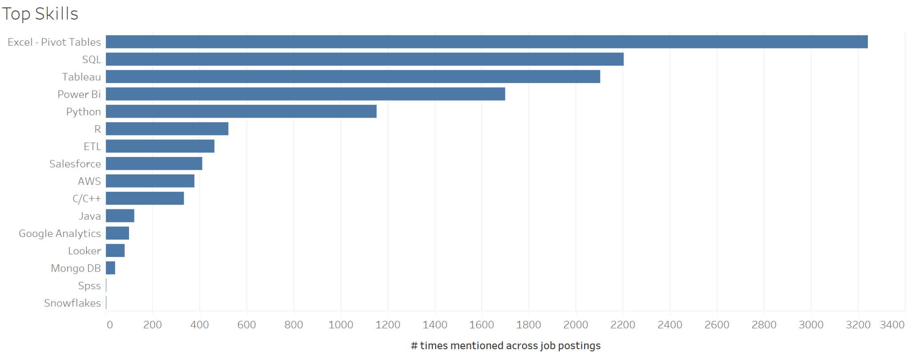
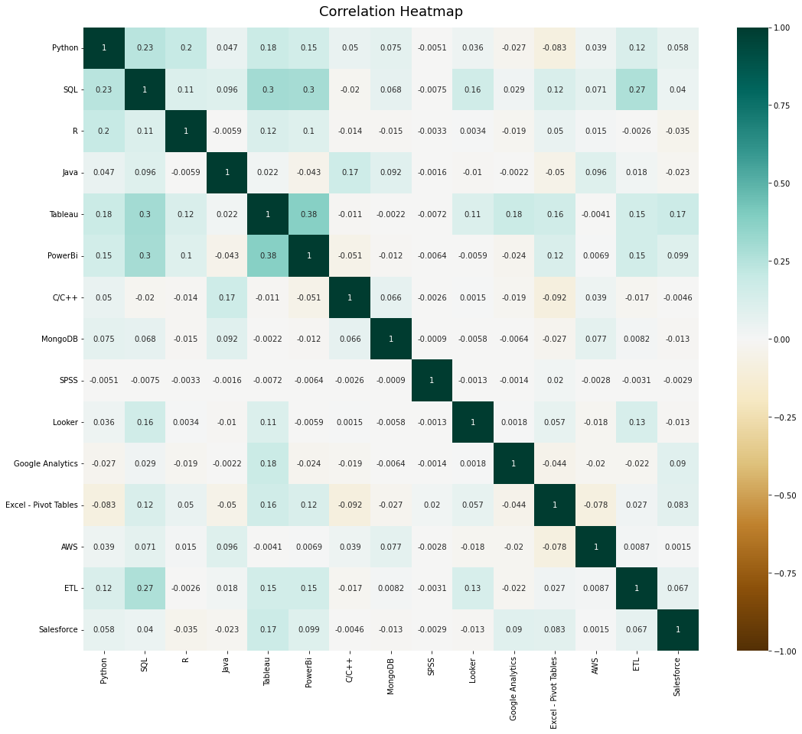

# Glassdoor Job Postings and Company Review Analysis

An academic group project using web scraping, keyword analysis, and sentiment analysis to explore analytics job requirements and employee feedback. This portfolio summary is based on the original Web Analytics final report.

[Portfolio project](https://shetty21.github.io/#/projects/glassdoor-job-analysis)

## Business question

Which skills appear most often in analytics job descriptions, where are the relevant roles located, and what sentiment appears in reviews of selected companies?

## Data and methods

- **10,084 job-posting records** covering analytics-related roles, including Business Analyst, Data Analyst, Data Scientist, and Machine Learning Engineer.
- A separate company-review sample covering **56 selected companies**.
- Python scraping with Selenium and BeautifulSoup, followed by field extraction and keyword matching using regular expressions.
- Excel and Google Sheets for tabular storage, with Tableau for reporting.
- Binary indicators recording whether each of 16 selected skills appeared in a description, followed by frequency and location comparisons.
- Word clouds and a skill-correlation heatmap.
- VADER compound scores for review sentiment. The report's appendix labels scores below zero as negative, zero as neutral, and above zero as positive.

The original dataset and collection dates are not available in this repository. The job-posting count and company count describe different samples and should not be combined.

## Reported findings

1. Excel and Pivot Tables, SQL, Tableau, Power BI, and Python were the five most frequently mentioned skills in the collected postings.
2. Remote roles appeared prominently in the location analysis. Among named cities, the report highlights New York for Excel, SQL, and Tableau roles, San Francisco for Python, and Washington, D.C. for Power BI.
3. The skill-correlation analysis did not identify strong positive or negative correlations.
4. The report describes predominantly positive company-review sentiment in its selected sample. This is a sample observation, not a representative assessment of all employees or companies.

## Business interpretation

The findings can inform a learning plan for analytics job seekers and help compare the tools mentioned in different role descriptions. They describe the collected historical sample rather than current hiring demand.

## Limitations

- Repeated postings and missing locations can affect counts and geographic comparisons.
- Keyword matches do not establish the level of proficiency required or whether a skill is mandatory.
- The review sample covers selected companies and is subject to selection bias.
- The sentiment thresholds above follow the submitted code and are not presented as a validated sentiment classifier.
- The report includes scraper and analysis snippets, but standalone source files, data exports, and a reproducible environment were not supplied. The reported results have not been rerun here.

## Materials and attribution

This was a group submission including Abhidith Shetty. Individual responsibilities are not separately asserted here.

This repository publishes the project summary and selected result figures. The full report remains private. The [portfolio cover](assets/portfolio-cover.png) is a website illustration, not an analytical result. No raw job descriptions, company reviews, credentials, or personal machine paths are distributed.
